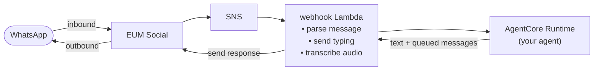

# 📱 Social Messaging Agent Runtime Toolkit

*Short name: **SMART**. Python package and CLI: `socialagent`.*

> **The open-source toolkit to build, ship, and operate WhatsApp AI agents on AWS.** Bring your agent — SMART owns the channel.


SMART turns **any** AI agent into a WhatsApp assistant on AWS. It owns the entire channel layer — webhook ingestion, message parsing, media, conversation memory, scheduling, external triggers, and template sync — and pairs it with a CLI, one-command infrastructure, and an admin console. Your team builds, ships, and operates conversation logic instead of rebuilding plumbing.

> **Anonymous deployment counter.** Each deployment creates one small CloudFormation stack, `<env>-<project>-deployment-metrics`, holding a single SSM parameter with an anonymous tracking code, so AWS can count deployments of this solution. No usage, message or customer data. To turn off the marker stack and its parameter, add this under your existing `terraform:` block in `socialagent.<env>.yaml` before the first deploy (the `TrackingId` tag stays; see below):
>
> ```yaml
> terraform:
>   enable_deployment_metrics: false
> ```
>
> What is emitted, and what is not: [Anonymous Operational Metrics](#anonymous-operational-metrics).

- **Opinionated on:** Amazon Bedrock AgentCore Runtime (agent hosting) + AgentCore Memory (conversation persistence).
- **Agnostic on:** agent framework (Strands, LangGraph, custom), LLM, and your business logic.
- **Counts deployments, nothing else:** the anonymous deployment counter above; `enable_deployment_metrics: false` turns it off ([details](#anonymous-operational-metrics)).
- **Written to be read by agents as well as people:** `AGENTS.md` at the root and in every scaffolded project carries the architecture rules, and the layering rules are tests (`make test-arch`), so a coding assistant working in this repo or in your project gets the same constraints a reviewer applies.

---

## Four pillars

SMART is a complete toolkit across the whole lifecycle — **build, develop, deploy, operate** — so your team ships conversation logic instead of plumbing.

### 🧩 Python SDK — owns the entire channel layer

Everything between WhatsApp and your agent, so you never touch the messaging plumbing:

- **Webhook ingestion & parsing** — signature validation and deeply-nested payloads normalized into a clean, developer-friendly shape
- **Media** — inbound audio transcription; outbound voice, image, and document delivery with the full S3 lifecycle handled
- **Conversation memory** — per-user, cross-session history via AgentCore Memory, plus optional per-user DynamoDB key-value state
- **Scheduling & external triggers** — recurring/one-shot reminders (EventBridge) and inbound events from any system (API Gateway)
- **Template sync & versioning** — defined in `templates.yaml`, GitOps-synced, with 24h-window-aware routing
- **Rich messages** — buttons, lists, media, and location

Your agent stays tiny because SMART does the rest — a full **Strands** agent with memory wired in:

```python
from bedrock_agentcore.runtime import BedrockAgentCoreApp
from strands import Agent
from strands.models import BedrockModel
from socialagent_runtime import create_session_manager, socialagent_notify_context, SocialAgentResponse
from src.model import MODEL_ID  # the blueprint's default model; see docs/configuration.md

app = BedrockAgentCoreApp()
model = BedrockModel(model_id=MODEL_ID)

@app.entrypoint
async def invoke(payload, context=None):
    agent = Agent(
        model=model,
        system_prompt="You are a helpful WhatsApp assistant. Keep replies short.",
        session_manager=create_session_manager(payload),   # AgentCore Memory, pre-wired
    )
    with socialagent_notify_context() as outbound:                 # capture any messages tools send
        result = agent(payload["prompt"], invocation_state={"phone": payload.get("phone", "")})
    return SocialAgentResponse(result=str(result), outbound_messages=outbound)

app.run()
```

SMART never touches what your agent thinks or decides — it's the channel between WhatsApp and your code, nothing more.

### 🛠️ CLI — from zero to a running agent in minutes

The `socialagent` CLI gets you building immediately:

- **`socialagent init [--blueprint]`** — scaffold a project, optionally from a **blueprint**: ready-made, adaptable solutions (`minimal`, `personal-assistant`, `appointment-scheduler`)
- **`socialagent dev`** — run the full message loop **locally, end-to-end** — no deployed stack, no ngrok, no WhatsApp account needed (your agent's own model calls still use your AWS credentials)
- **`socialagent recipe add`** — drop in capabilities on demand (**recipes**): reply with buttons and lists (`rich-messages`), voice replies (`voice-reply`), image generation (`generate-image`)

### 🚀 Infrastructure as Code — one command, in your account

The entire stack is Terraform — deploy it from your project with a single command:

```bash
uv run socialagent deploy
```

Provisions the Lambda functions, SNS, API Gateway, EventBridge Scheduler, AgentCore Runtime + Memory, and optional DynamoDB state — all in **your** AWS account, with no third-party SaaS in the path.

### 📊 Admin Console — manage & observe deployed stacks

*Beta: the console works and is documented, and every route is authorized deny-by-default and tested, but it has had less production time than the SDK and CLI. It is a separate Terraform root; a deployment without it loses nothing else.*

A dashboard to operate everything you've shipped: view stacks and health, inspect conversations and per-user state, manage phone numbers and templates, review schedules, trigger events, and read logs — across all your deployments. Health and metrics come from CloudWatch; agent traces are emitted via AgentCore Observability (OpenTelemetry).

---

## The channel layer you don't have to build

Shipping a production WhatsApp bot on AWS from scratch means wiring **10+ services** and weeks of undifferentiated work. SMART collapses that to **under a day** for a first working bot:

| Concern | Without SMART | With SMART |
|---------|-------------|-----------|
| **Webhook ingestion** | HTTPS setup, verify-token handshake, byte-exact HMAC-SHA256 validation | Handled automatically — zero validation code |
| **Message parsing** | Deeply nested, type-dependent JSON; defensive extraction | Normalized into a consistent, developer-friendly shape |
| **Media** | Fetch → download → convert → store in S3 → clean up (expire objects and their old versions) | Full lifecycle automated, both directions ([how long media is kept](docs/media.md#how-long-media-stays-in-s3)) |
| **Templates & 24h window** | Meta approval flow, utility-vs-marketing traps, window math | Template sync + window-aware routing built in |
| **Memory & state** | Multi-tier memory, DynamoDB, session-break handling | AgentCore Memory with cross-session continuity |
| **Infrastructure** | 10+ AWS services stitched together | A single `terraform apply` |
| **Local dev** | Redeploy + ngrok on every change | `socialagent dev` — full local simulation |

---

## Quick Start

From zero to a deployed bot in three steps, run from a clone of this repo:

```bash
git clone https://github.com/awslabs/social-messaging-agent-runtime-toolkit.git
cd social-messaging-agent-runtime-toolkit

# 1. Scaffold a project (run inside the SMART repo — auto-detects the monorepo)
uv run socialagent init my-whatsapp-bot

# 2. Run it locally — no deployed stack, no WhatsApp needed
cd projects/my-whatsapp-bot
uv run socialagent dev

# 3. Deploy the whole stack to your AWS account
#    (first set whatsapp.phone_number_id in socialagent.dev.yaml)
uv run socialagent bootstrap   # first time per account
uv run socialagent deploy
```

> The `bootstrap` step creates the Terraform state backend, once per account and stage.
> The deploy also creates the deployment marker stack of the anonymous deployment counter (`socialagent deploy` prints a line saying so); `terraform.enable_deployment_metrics: false` in `socialagent.dev.yaml` turns it off ([what is emitted](#anonymous-operational-metrics)).
> See [Getting Started](docs/getting-started.md) for the full walkthrough.

`socialagent init` scaffolds everything you need:

```
projects/my-whatsapp-bot/
├── agent.py              # Your agent — deployed to AgentCore Runtime
├── socialagent.dev.yaml  # The project's configuration (see docs/configuration.md)
├── handlers/
│   ├── webhook.py        # Inbound messages (SNS trigger)
│   ├── notification.py   # Outbound messages (direct invocation)
│   ├── event.py          # External events — add @app.on_event here (API Gateway)
│   └── scheduler.py      # Scheduled messages — add @app.on_schedule here (EventBridge)
├── socialagent_runtime/  # Vendored agent-side helpers (copied in by socialagent init)
├── Dockerfile
└── requirements.txt
```

The `personal-assistant` and `appointment-scheduler` blueprints also ship a `templates.yaml` of WhatsApp message templates and a `src/` with their tools and skills.

Pick a starting point with a **blueprint**:

```bash
uv run socialagent init my-bot --blueprint personal-assistant   # minimal | personal-assistant | appointment-scheduler
```

---

## How It Works


*The three boxes are the three Terraform roots you actually apply. Inside the core stack, read the swimlanes left to right: a message arrives through End User Messaging Social, fans out over SNS to the webhook Lambda, reaches the agent runtime, and the reply goes back the same way; external events and schedules are the two other entry points. Components with a dashed border are off unless you set the flag named on them. For a closer look, [`architecture.svg`](docs/assets/architecture.svg) is the same diagram as vector and stays sharp at any zoom. Editable source: [`architecture.drawio`](docs/assets/architecture.drawio) ([draw.io](https://www.drawio.com/)). WhatsApp and Terraform are drawn with generic AWS icons rather than their logos, with the product names as labels.*

SMART deploys three Lambda functions by default — `webhook` (inbound via SNS), `notification` (outbound) and `event` (API Gateway) — plus an API Gateway authorizer. A fourth, `scheduler` (EventBridge), runs your `@app.on_schedule` handlers; every blueprint turns it on, since without it schedules reach `notification`, which rejects them. Inbound is the core loop:



Shared infrastructure: **AgentCore Memory** (conversation history, shared between your agent and SMART) and an optional **DynamoDB** table for per-user state. See [Architecture](docs/architecture.md) for the Lambda roles, the two-layer model, and the full message flow.

---

## Code examples

**Schedule a follow-up** — from a tool or handler. The operation name routes to an `@app.on_schedule` handler:

```python
from socialagent_runtime import scheduler

# One-shot reminder in 60 minutes
await scheduler.schedule("reminder", phone, delay_minutes=60,
                         data={"message": "Time for your appointment 🪥"})

# Recurring — every day at 14:00 UTC
await scheduler.schedule("daily_summary", phone, cron="cron(0 14 * * ? *)",
                         data={"prompt": "Send the user their daily summary"})
```

**React to an external event** — `handlers/event.py`. Any system (CRM, orders, webhooks) POSTs to the event API:

```python
from socialagent import SocialAgentApp, SocialAgentConfig
from socialagent.handlers.event import EventContext

app = SocialAgentApp(SocialAgentConfig.from_env())

@app.on_event("order_shipped")
async def on_order_shipped(event: dict, ctx: EventContext) -> None:
    await ctx.send_template(event["phone"], "order_shipped",
                            [event["order_id"], event["eta"]])

handler = app.event_handler()
```

**Send media & rich messages** — build a payload and send it:

```python
from socialagent_runtime import notify, messages

await notify.send_message(phone, messages.image(url, caption="Your receipt"))
await notify.send_message(phone, messages.buttons("Pick a slot:", ["Tue 10am", "Wed 2pm"]))
```

Inbound voice notes are transcribed automatically — your agent just reads `payload["prompt"]`; images and documents are passed through. For media you've stored in the stack's bucket under `voice/`, `images/` or `media/`, `notify.upload_media(bucket, key)` returns a WhatsApp `media_id` ([Media](docs/media.md#media-stored-in-s3)).

---

## Who It's For

**Developers & startups** building WhatsApp-first products (LATAM, India, SEA, and beyond):
- `socialagent dev` for local-first iteration — no ngrok dance, no redeploy loop
- The same code runs from prototype to production
- Open source — no feature gates, no vendor lock-in

**Platform & architecture decision-makers** (PMs, staff engineers, solutions architects) choosing the stack:
- **Data sovereignty** — the stack stores conversations, memory, and media in your AWS account; the calls that process content outside the stack's Region or outside AWS, WhatsApp delivery through Meta among them, are listed in [Data Flows and Regions](docs/data-flows.md)
- **Built for security review** — auditable open source, deployed as Terraform IaC, with a published [threat model](docs/threat-model.md)
- **Fits your AWS estate** — native Bedrock + AgentCore; the only party outside AWS is Meta's WhatsApp Business Platform, which the channel requires
- **Predictable cost** — compute that scales to zero when idle, no per-seat licensing. A few resources still bill a small amount every month, idle or not: the CloudWatch dashboards and alarms beyond the account's free tier, the Secrets Manager secrets, the admin console's KMS key if you deploy the console, and stored data: the agent image, S3 objects (the CloudTrail and Bedrock audit logs among them) and CloudWatch logs. `enable_security_logging = false` turns the audit logging off; `enable_transaction_search = false` keeps a new stack from turning on CloudWatch Transaction Search, which a stack that already turned it on must turn off by hand ([Configuration](docs/configuration.md#terraform))

### Where SMART fits

SMART is **not** a no-code bot builder and **not** a managed messaging vendor. It's the **channel-infrastructure toolkit** between your AWS account and WhatsApp: it gives you production plumbing (like a BSP) deployed as IaC in your own account (unlike a BSP), while staying agent-agnostic and open source. You own the agent logic; SMART owns the channel.

---

## Guides

- [Architecture](docs/architecture.md) — the two-layer model, message flow, and notify paths
- [Getting Started](docs/getting-started.md) — scaffold, configure, deploy
- [Building with SMART](docs/building-with-socialagent.md) — the standalone guide for building a project on SMART, also shipped into every scaffolded project as `SOCIALAGENT_GUIDE.md`
- [Agent Integration](docs/agent-integration.md) — Strands, custom agents, hooks
- [Notifications](docs/notifications.md) — sending from tools and handlers, memory write rules
- [Templates](docs/templates.md) — define, sync, and send WhatsApp templates
- [Events & Scheduling](docs/events-scheduling.md) — external triggers and scheduled messages
- [Media Handling](docs/media.md) — voice notes, images, documents
- [State](docs/state.md) — per-user key-value state with DynamoDB
- [Local Development](docs/local-dev.md) — the `socialagent dev` interactive REPL
- [Configuration Reference](docs/configuration.md) — all config options and env vars
- [Admin Console](docs/admin-console.md) — the management dashboard for deployed stacks
- [Data Flows and Regions](docs/data-flows.md) — content processed outside the stack's Region or outside AWS: cross-Region inference, image generation, Transcribe and Polly, WhatsApp delivery
- [Threat Model](docs/threat-model.md) — trust boundaries, threats, mitigations, and accepted risks

---

## Requirements

- **Python 3.11+** (the Lambda functions and the agent runtime run 3.12)
- An **AWS account** with AgentCore Runtime and AgentCore Memory available
- **AWS End User Messaging Social** (EUM Social) with a linked WhatsApp Business Account
- [`uv`](https://docs.astral.sh/uv/getting-started/installation/) for dependency management
- [Terraform](https://developer.hashicorp.com/terraform/install) >= 1.7 for deployment
- The **AWS CLI** on `PATH` with credentials (Terraform's provisioners call it)

---

## Before real traffic

The defaults suit a first deployment. Decide these before a bot takes real users; [SECURITY.md](SECURITY.md#scope-notes-for-deployers) gives the detail and the [Threat Model](docs/threat-model.md) the accepted risks behind them.

- **Rate limiting** — the per-user limit (`rate_limit_per_minute`, 20 messages a minute by default) is enforced only with the DynamoDB state table, and `features.state_table` defaults to `false`. The `socialagent.dev.yaml` the `personal-assistant` and `appointment-scheduler` blueprints ship turns it on, and `socialagent config init --env <env>` copies the `features:` of an existing environment's file into the one it writes; `minimal` leaves it off. Until you set `features.state_table: true` in `socialagent.<env>.yaml`, any WhatsApp user can drive unbounded paid model calls, and the webhook only logs a warning at cold start.
- **Admin console TLS** — on CloudFront's default `*.cloudfront.net` certificate the console accepts TLS 1.0 and 1.1. In production serve it on a custom domain with an ACM certificate and the `TLSv1.2_2021` security policy ([Serving the console on a custom domain](docs/admin-console.md#serving-the-console-on-a-custom-domain)).
- **Access logging** — the per-stack media bucket delivers S3 server access logs to the audit-trails bucket, and the console's own registry bucket (created only when the console's `shared_runtime_bucket` is empty) to itself; each target bucket's policy grants `logging.s3.amazonaws.com` the `s3:PutObject` that S3 needs to deliver the logs, so check after a deploy that they arrive ([SECURITY.md](SECURITY.md#scope-notes-for-deployers)). The audit-trails bucket does not log its own access, as AWS advises against a bucket logging to itself, and the registry's logs, which include S3's logs of its own log deliveries, expire after about 90 days. The event API and the console's API have access logging to CloudWatch Logs. The console's CloudFront distribution and site bucket, the build buckets (template-sync among them), the Terraform state buckets and the shared runtime and artifacts buckets (the shared runtime bucket also holds the console's stack registry, under `admin/registry/`) have none: turn on what your audit policy needs as production hardening.
- **AWS WAF** — neither the stack nor the admin console creates a web ACL. Attach a regional one to the event API's stage and one with CloudFront scope, created in us-east-1, to the console's distribution; the console's API is an HTTP API, which AWS WAF does not support.

---

## Roadmap

SMART is in **beta**. What ships next, what is deferred and why, and the longer-term channel primitives (`handoff`, a structured event bus, channel adapters, console analytics) are in [ROADMAP.md](ROADMAP.md).

---

## Contributing

Bug reports and feature requests go to [GitHub issues](https://github.com/awslabs/social-messaging-agent-runtime-toolkit/issues), and pull requests are welcome — see [CONTRIBUTING.md](CONTRIBUTING.md) for how to propose a change and [AGENTS.md](AGENTS.md) for an architecture-oriented overview of the codebase. Report security issues privately as described in [SECURITY.md](SECURITY.md), not in a public issue.

## License

[Apache-2.0](LICENSE) © Amazon.com, Inc. or its affiliates. See [NOTICE](NOTICE) for attribution.

## Trademarks

WhatsApp is a trademark of Meta Platforms, Inc. This project integrates with WhatsApp through AWS End User Messaging Social and is neither affiliated with, endorsed by, nor sponsored by Meta Platforms, Inc. All other trademarks are the property of their respective owners.

## Anonymous Operational Metrics

Each deployment creates a small CloudFormation stack whose description carries an anonymous tracking code, so AWS can count how many times this solution is deployed. It contains one free SSM Standard parameter and nothing else, and no other resource depends on it. Collected: the fact of a deployment. Not collected: usage data, message content, conversation data, or customer data. Opt out with `terraform.enable_deployment_metrics: false` in `socialagent.<env>.yaml`, before the first deploy (turning it off later adds a deletion and does not undo the count). It removes the stack but not the `TrackingId` tag carrying the same code on every taggable resource; that tag is not collected. Full detail, including the extra IAM permissions it needs, is in [infra-terraform/README.md](infra-terraform/README.md#operational-metrics-collection).

How AWS handles the information it collects is described in the [AWS Privacy Policy](https://aws.amazon.com/privacy/).

| What is emitted | Where | Used for |
|-----------------|-------|----------|
| The deployment marker stack, `<env>-<project>-deployment-metrics`: a CloudFormation stack whose description names this solution and carries the anonymous tracking code in parentheses, followed by a `(tag:core)` suffix and the solution version, for example `(v2026.10.0)` | Your AWS account, created by your own credentials (`infra-terraform/metrics.tf`) | Counting deployments. The description is the only field this solution adds for the counter; like any stack, the count is tied to the account, Region and stack name, and to when the stack was created and deleted |
| The stack's one resource: an SSM Standard parameter, `/<env>-<project>/deployment-metrics/tracking-code`, whose value is the same code | Your AWS account, inside the marker stack | Nothing. CloudFormation requires a template to declare at least one resource, so this is the marker; nothing in the solution reads it back, and you can read it yourself to check the disclosure |
| The `TrackingId` tag, carrying the same code | Every taggable resource the deployment creates, set in `common_tags` (`infra-terraform/locals.tf`) and applied as the provider's `default_tags` (`infra-terraform/main.tf`) | Nothing. The tag is not an ingestion path and is not collected |
| Not collected | — | Usage data, message content, conversation data or customer data. Nothing beyond what AWS already sees in its own CloudFormation control plane for any stack your credentials create |

`terraform.enable_deployment_metrics: false` in `socialagent.<env>.yaml` removes the marker stack and its parameter. It does not remove the `TrackingId` tag; to drop that too, delete it from `common_tags` in `infra-terraform/locals.tf`. While the marker is on, `socialagent deploy` (`--plan` included) prints one line saying so before Terraform runs.

---

## Disclaimer

> This is sample code, for non-production usage. You should work with your security and legal teams to meet your organizational security, regulatory and compliance requirements before deployment.
