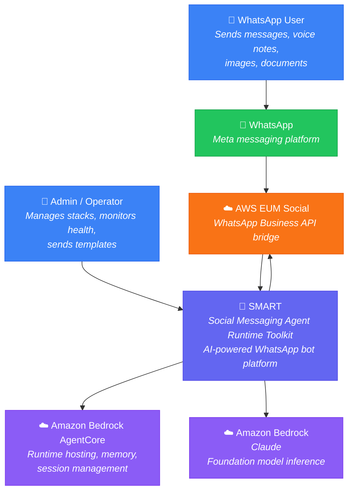
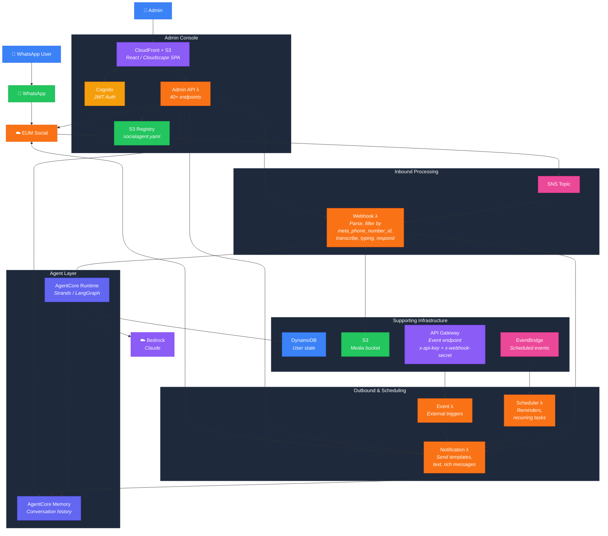
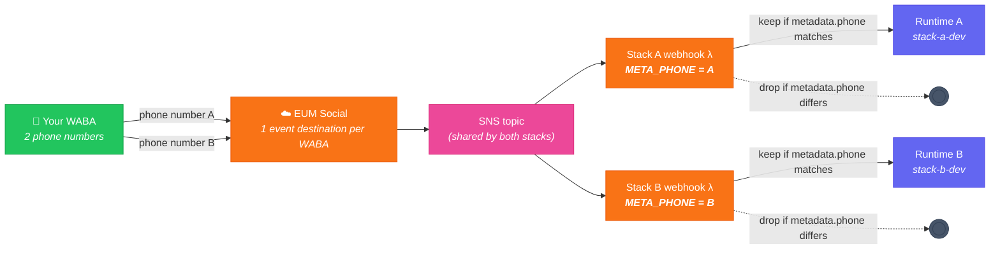
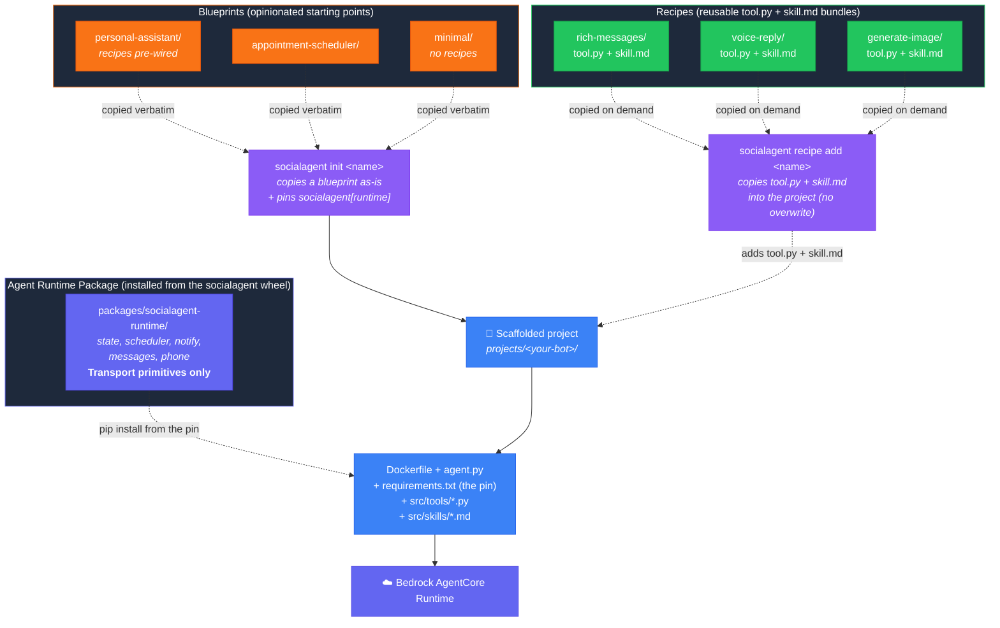

# SMART — C4 Model Diagrams

## Level 1: System Context

## Level 2: Container Diagram (single stack)

## Level 2 (variant): Shared WABA → shared SNS

Two or more stacks using phone numbers under the same WhatsApp Business Account (WABA)
must share a single SNS topic because EUM Social allows only one event destination per WABA.
Each stack's webhook filters incoming SNS events by `SOCIALAGENT_META_PHONE_NUMBER_ID` and drops
messages destined for its sibling.

## Level 3: Scaffolding model (build-time)

SMART source is organized into distinct build-time roles. Blueprints and recipes are a scaffolding model: they are templates copied into a project by `socialagent init` and `socialagent recipe add`, never imported at runtime. The agent runtime is not copied: the `socialagent` wheel installs it as `socialagent_runtime`, and each project pins that release in its `requirements.txt`.

**Scaffolding roles:**

| Role | Can user modify? | Mechanism |
|---|---|---|
| Agent Runtime Package (`packages/socialagent-runtime/`) | No — it is a dependency | Installed as `socialagent_runtime` from the release `requirements.txt` pins (`socialagent init` writes the pin, `socialagent runtime update` moves it); a project an older CLI scaffolded carries a copy until `runtime update` replaces it |
| Recipes (`recipes/*`) | Yes, their own copy | Copied into the enclosing project on demand by `socialagent recipe add` (never overwrites existing files) |
| Blueprints (`blueprints/*`) | Yes, their own copy | Copied verbatim at `socialagent init` |

There is no manifest, no auto-discovery, and no runtime include/exclude filtering. A project's tools and skills are whatever files it ships.
